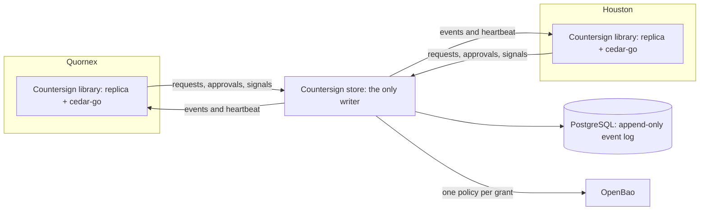

# Countersign

Countersign is a design for one permission engine for people and AI agents across Orvex's Quornex and Houston. It decides who may do what, where, and for how long, and it explains and records every decision. Agents start with nothing. Contained actions are approved by rules, and production, real secrets, money and deletion always wait for a person.

This repository is Skander's answer to the Orvex AI intern design brief. It holds a product brief, a PRD, an architecture with diagrams, a two-engine spike with measurements and formal proofs, and a log of how AI was used.

## The hand-in

| Asked for | Where |
|---|---|
| The PRD | [prd.md](_bmad-output/planning-artifacts/prds/prd-countersign-2026-11-06/prd.md), with Danny's answers paraphrased in its [addendum](_bmad-output/planning-artifacts/prds/prd-countersign-2026-11-06/addendum.md) |
| The architecture, with diagrams | [architecture.md](_bmad-output/planning-artifacts/architecture/architecture-countersign-2026-11-11/architecture.md) to read; [ARCHITECTURE-SPINE.md](_bmad-output/planning-artifacts/architecture/architecture-countersign-2026-11-11/ARCHITECTURE-SPINE.md), whose 23 decisions are binding |
| The grant schema | [grant-schema.md](_bmad-output/planning-artifacts/architecture/architecture-countersign-2026-11-11/grant-schema.md) |
| The fixed rules in the chosen engine | [policies.cedar](spike/cedarengine/policies.cedar) and [policies.cedarschema](spike/cedarengine/policies.cedarschema) (cedar-go) |
| A decision table of 25 checks, 5 of them attacks, with spike results | [decision-table.md](_bmad-output/planning-artifacts/architecture/architecture-countersign-2026-11-11/decision-table.md), [spike-results.md](_bmad-output/planning-artifacts/architecture/architecture-countersign-2026-11-11/spike-results.md) |
| The AI log, with the times the AI was overruled | [AI_LOG.md](AI_LOG.md) |
| This README, ending with open questions | below |

**Also here:**
- **The product brief:** [brief.md](_bmad-output/planning-artifacts/briefs/brief-countersign-2026-10-30/brief.md).
- **How the engine was chosen:** [spike-preregistration.md](_bmad-output/planning-artifacts/architecture/architecture-countersign-2026-11-11/spike-preregistration.md), with the thresholds written before measuring and every later change dated. [spike-results-history.md](_bmad-output/planning-artifacts/architecture/architecture-countersign-2026-11-11/spike-results-history.md) keeps every run.
- **The formal proofs:** [symcc-results.md](_bmad-output/planning-artifacts/architecture/architecture-countersign-2026-11-11/symcc-results.md).
- **What the spike didn't do:** [KNOWN-LIMITS.md](spike/KNOWN-LIMITS.md).
- **The architecture reviews and what happened to each finding:** [triage.md](_bmad-output/planning-artifacts/architecture/architecture-countersign-2026-11-11/reviews/triage.md), [bmad-review-2026-11-26.md](_bmad-output/planning-artifacts/architecture/architecture-countersign-2026-11-11/reviews/bmad-review-2026-11-26.md).

## How it was made

The work followed the BMAD method, in this order:
1. product brief
2. PRD
3. architecture, with a spike
4. review

AI helped at every step. [AI_LOG.md](AI_LOG.md) records what it did, what Skander decided, and where Skander overruled it. Danny's emails are paraphrased, not quoted.

## The design in brief



- **Checks are local.** Each product embeds a library that answers checks from a read-only replica, with no network call. The one exception is a high-risk check, which records its decision at the store before answering.
- **One writer.** One store per installation appends every change to an append-only event log.
- **The engine only decides.** The layer computes the facts, and cedar-go decides. The fixed rules are Cedar policies, and SymCC proves properties of them.
- **Fail closed.** A replica that falls behind refuses high-risk checks within 10 s and everything after at most 5 minutes (tentative). Anything malformed, unknown or stale refuses.
- **OpenBao follows Countersign.** It gets one policy per grant, narrowed by every ancestor, and removed when any ancestor ends.

[architecture.md](_bmad-output/planning-artifacts/architecture/architecture-countersign-2026-11-11/architecture.md) explains all of this with seven diagrams.

## What the spike shows, and what it doesn't

**Shown:**
- **The decision logic works on three engines.**
  - 75 tests per engine, with the race detector, pass on cedar-go, OPA and a reference engine written in Go. Last run 2026-11-26.
  - A differential test feeds every engine the same crafted inputs.
- **The engine choice was made by a rule written down before measuring.** Run 6 used 50,000 grants, written while checks ran.
  - Both candidates passed all 25 decision-table rows, with no wrong allows.
  - On the typical prefiltered path, cedar-go's p99 was 41 µs and OPA's 91 µs, against a 250 µs target. OPA was 2.2× slower, past the pre-registered 2× line, so cedar-go was chosen.
- **14 properties of the Cedar policies are proved** with SymCC and the cvc5 solver, for every request the schema allows. Two deliberately false claims were refuted, so the proofs aren't vacuous.

**Not shown:**
- **The margin is thin.** 2.2× against a 2× line was measured on a shared virtual machine. Earlier unpinned runs gave about 1.0 and 1.9.
- **The full path (259 µs) and the worst case (415 µs, every engine) miss 250 µs.** In the worst case, OPA was faster. The scope index that must fix the worst case isn't built.
- **Rows 22 and 24 of the decision table are replacements.** The originals, a replica cut off from the store and replay, never ran.
- **The proofs cover less than all of Countersign.** They cover agents and the `push` action, under Rust Cedar's semantics. They take the layer's facts as given. They were run once by hand; the CI job isn't built.
- **The spike built none of these:** the store, the replicas, replication, OpenBao enforcement, decision records or replay. They're designed, not built or measured.

[KNOWN-LIMITS.md](spike/KNOWN-LIMITS.md) lists every limit.

## Running the spike

You need Go 1.27, and Rust with cvc5 1.3.1 for the proofs.

```sh
cd spike

# Every test, on every engine, with the race detector
./check.sh

# The measurements; writes results/results.md
taskset -c 1-3 env GOMAXPROCS=3 go run ./cmd/harness

# The SymCC proofs; writes results/symcc.md
cd symcc && CVC5=/path/to/cvc5-1.3.1/bin/cvc5 cargo run --release
```

The spike is a prototype for measuring, not the product. It differs from the architecture in places, for example in how tasks close. architecture.md §12 lists the differences.

## Open questions

### Decided, not built

- **B3, a restored event log:**
  - The log has a history ID, minted again on every restore, and every event carries the hash of the previous one.
  - A replica that sees a different history ID, or a broken chain, halts and refuses every check until an operator reloads a snapshot.
  - **Until it's built:** after any PostgreSQL restore, stop the store and re-initialise every replica from a fresh snapshot before writes resume.
  - **Known limit:** If an operator recreates the database without the restore procedure, the history ID doesn't change, but the hash chain still catches the fork when a replica resumes. The protection fails only if the restored events are identical to what the replica applied.

### Open risks

1. **B10, the high-risk record call.** These are open:
   - whether the store re-checks a decision against newer events
   - where records live
   - how retries are handled
   - how contained-check records survive a crash
   - what a list sends

   Until it's settled, "every decision is recorded" doesn't hold for contained checks.
2. **The production gate.** "Splitting can't get around approval" depends on Quornex routing every production merge or sync through a Countersign check. That isn't confirmed with Danny.
3. **Closing signals.** The design assumes Quornex and Houston reliably send "task opened", "task closed" and "agent ended".
4. **Rule-approved grants after a re-marking.** A grant approved by rules keeps allowing after its action is re-marked human-only, until a planned v1 `forbid` is in place.
5. **A reused service-account name** could inherit the old agent's OpenBao policies before the reconciler acts.
6. **Read-your-writes** covers only the replica of the product that made the write, and has no stated timeout result.
7. **Operations aren't assigned yet:** reconciliation and drift intervals, alert recipients, and named owners for deployment, observability, backup and restore, migrations and tamper detection.
8. **Identity rests on the products.** The store trusts the identity a product asserts over mTLS. Countersign itself checking that the caller matches is deferred.

### Questions for Danny

1. **Sam's case.** Sam starts `api-refactor`, it asks to deploy to production, and Sam approves. Is that self-approval? Sam and the agent are different principals, and the self-approval proof covers person requesters only. The PRD follows Danny in excluding only the exact requester. A reviewer proposed refusing this case by default until he answers.
2. **Hand-down.** Is hand-down within a person's sharing limit, with agents never approving, what he meant by "a parent can approve for its child"? Relatedly, is "anything requiring a human still goes to a human" met by a person deciding once, when approving a grant and its sharing limit (PRD §9, question 1)?
3. **Does each installation have its own PostgreSQL?** The architecture depends on it.
4. **Unclassified resources count as production.** That widens the floor-of-four assumption. Is that acceptable?
5. **Are Argo CD, Harbor and Grafana still in the plan?** Also, will Quornex build the production gate?
6. **Service grants:** is a hard maximum lifetime with a review date acceptable, given they "last on their own"? What is the maximum? Who takes over when the owning team disappears?
7. **What are customer admins' roles,** and are they the installation administrators?

### PRD changes to raise with the PRD owner

1. **FR-17 contradicts FR-16:** withdrawing a service grant withdraws its children, but a service grant is never handed down.
2. **FR-3 would end service grants** when their creator's task closes or agent ends.
3. **FR-1 makes the duration mandatory,** so FR-3's 8-hour default can never apply.
4. **A contained request over 4 hours is refused,** though a person could approve it. That contradicts "refuse is for what no approval could allow".
5. **NFR-4's "an unauthenticated identity is refused" is now each product's job.**
6. **A withdrawn contained grant comes straight back,** because rules re-approve it, so UJ-3's containment fails for contained actions. Add a block on rule approval after a withdrawal for cause.
7. **Pending requests have no lifecycle:** approve or reject, lifetime, cancellation, and re-checking at approval time.
8. **How actions and resources become "known"** isn't specified, so "unknown: refuse" can't be told apart from "unmarked: ask".
9. **A person can create and approve their own service grant.**
10. **Administrators:**
    - With two of them, a compromised one can't be removed.
    - The 14-day staggering needs a long maximum lifetime, and an expiry can leave fewer than two.
11. **Forged closing signals** under the alert threshold can end production grants quietly.
12. **Narrowing doesn't trigger OpenBao removal,** so "never wider, even for a moment" can't hold.
13. **Records and replay:**
    - One record or 10,000 per list?
    - Whether the 250 µs target covers checks recorded before answering.
    - Keeping old library versions for replay.
    - A drift-detection target.
14. **FR-13 is worded as a guarantee** that depends on Quornex.

### Not decided yet, by design

- **Values:** the first staleness horizon and the clock margin, the scope index's structure, a time budget for lists, record retention beyond a month.
- **Mechanisms:** how closing signals are authenticated, setting the first administrator, and recovery when every administrator has lapsed.
- **Not yet proved:** a parent agent's hand-down never gives either agent more than the parent could do itself (PRD §9, question 15).
