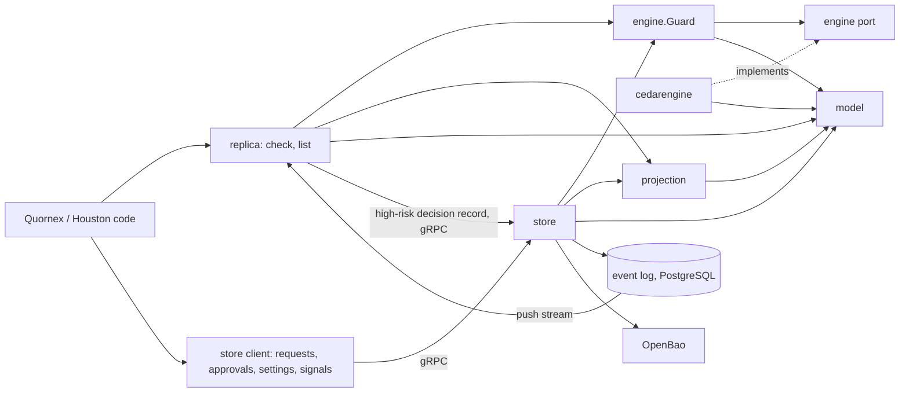
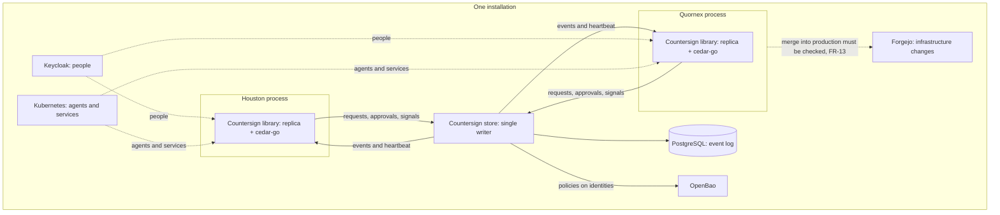

# Architecture Spine: Countersign

## Design Paradigm

- **Write side:** one store per installation is the **single writer** to an **append-only event log**. Every change is an event. Current state is a projection of the log, and the state version is the log position (event sourcing).
- **Read side:** every product embeds the library, which holds a **read-only replica** of that state, fed by the log. Checks never leave the process (CQRS).
- **The policy engine sits behind a port** (hexagonal). The layer gathers facts, the engine only decides, and the engine is cedar-go.

| Layer | Package (spike → product) | Owns |
|---|---|---|
| Model | `model/` | typed identities, canonical paths, records |
| Engine port | `engine/` | the `Engine` interface and the input `Guard` |
| Engine adapter | `cedarengine/` | Cedar entities, `policies.cedar`, `policies.cedarschema` |
| Projection | `ref/` state → `projection/` | the one fold of the log into state, and every derived fact; the snapshot format |
| Replica (read side) | `ref/` check path → `replica/` | index, prefilter, chain facts, staleness, clock |
| Store (write side) | `ref/` write path → `store/` | write-time rules, the event log, OpenBao reconciliation |

## Invariants & Rules



Dependencies point only along the arrows. The engine never reads the log. The replica never writes, except to send a high-risk decision record to the store (AD-14). Nothing but the store writes to PostgreSQL or OpenBao.

### AD-1: One writer per installation; checks are local, except one call for a high-risk record [ADOPTED; decided, not measured]
- **Binds:** FR-1–FR-10, FR-14, FR-16, FR-19, FR-20, FR-25, FR-29; NFR-3, NFR-4
- **Prevents:** two products or two processes writing different histories; a network call on every check
- **Rule:**
  - Only the installation's store writes: requests, approvals, withdrawals, signals, markings, classifications, authority and audit.
  - Products never write to the database.
  - **The single writer is enforced (Skander's decision D14):** the store holds a PostgreSQL advisory lock for its whole lifetime. A process without it serves no writes and runs no OpenBao reconciler. There is one active store per installation in v1.
  - **The writer is fenced (B1):** a store can't know at once that it has lost a session lock, so:
    - every append transaction also takes the advisory lock with transaction scope (`pg_advisory_xact_lock`) on its own connection
    - every append is a **compare-and-append**: it inserts only if the log's head is still the position, **and the head hash** (AD-2), that the store checked its rules against. If no row is inserted, the store reloads and retries, or halts.
    - a **writer epoch** goes up in a row each time a store takes the lock. Before each OpenBao write, the reconciler checks that the epoch is still its own, and it writes the epoch into the policy's metadata. A reconciler that sees a newer epoch in OpenBao stops.
    - Layer test: two store processes, one losing its lock mid-flight. Neither appends against a stale head, and the loser makes no OpenBao write after the winner's first one.
  - `check` and `list` run in-process against the local replica, with no network call, **with one exception (Skander's decision D1):** a high-risk check makes one synchronous call to the store to record its decision before answering (AD-14). It's the only network call allowed in the check path.
  - **NFR-3's 250 µs applies to contained checks.** A high-risk check adds that round trip, which hasn't been measured.

### AD-2: An append-only event log in the installation's PostgreSQL [ADOPTED; decided, not measured]
- **Binds:** FR-24, FR-25, FR-29, NFR-6
- **Prevents:**
  - a missed withdrawal from out-of-order or gapped positions
  - a change without its audit record
  - history being edited
- **Rule:**
  - Each change is one event. The store appends one at a time, taking the next position under a lock in the same transaction, so positions have **no gaps** and **commit order equals position order**.
  - A change, its audit record and its position commit together, or not at all.
  - **Write rules are checked against the projection at position N−1, inside the transaction that appends N** (D14), so two concurrent writes can't both pass against the same state.
  - The application's database role has no `UPDATE` or `DELETE` on the log.
  - **The log has a history ID (Skander's decision B3; decided, not built, not measured):** a ULID or UUID, never a counter. It's minted when the log is created, and **minted again on every restore** by the restore procedure (Deferred, operations).
  - **Every event carries the hash of the previous event,** computed in the transaction that appends it. The compare-and-append (AD-1) checks the head position and the head hash.
  - The state version is the log position.

### AD-3: Replication by a resumable push stream with a heartbeat [ADOPTED; decided, not measured]
- **Binds:** FR-19, FR-20, NFR-2, NFR-6
- **Prevents:** replicas that silently fall behind; the replica and store disagreeing about time
- **Rule:**
  - The store pushes events over a gRPC stream. A replica resumes after its last applied position, **sending its history ID and head hash** (B3, AD-21).
  - The heartbeat is the latest position plus the store's time, **plus the history ID and the head hash** (B3), every 1 s. It drives both freshness and clock offset. **Its time T is read from the store's clock before reading the committed head H** (B6), so it guarantees that every event committed at or before T has a position at most H. Heartbeats are sent on the stream after every event up to H. Layer test: a delay between commit and the head update never makes freshness pass the commit time of an unapplied event.
  - **Read-your-writes (Skander's decision D11):** every store write response carries the log position it committed at. A check may name a minimum position. If the replica hasn't applied it, the check waits up to a deadline (an installation limit, AD-22), then refuses with `replica.behind`. Product clients do this after their own writes, including withdrawals.
  - A new replica loads a store-built **snapshot named by its history ID and position**, carrying the head hash (B3), then the events after it. A snapshot is never a second source of truth: it's the `projection/` state at a position, written and read by the same code (AD-19).

### AD-4: A stale replica fails closed in two steps [ADOPTED; decided, not measured]
- **Binds:** NFR-1, NFR-2, NFR-6, FR-19
- **Prevents:** a withdrawn grant being honoured indefinitely by a cut-off replica
- **Rule:**
  - After the first horizon (no more than the 10 s withdrawal target), a stale replica refuses **high-risk** checks, meaning anything not marked contained.
  - After the second, longer horizon, it refuses **everything**.
  - **Freshness counts applied events, not received heartbeats (Skander's decision D4):**
    - A replica's freshness instant is the store time of the latest heartbeat whose position the replica has **applied**. A heartbeat the replica hasn't caught up to doesn't refresh it.
    - Staleness is `now` minus that instant. Receiving the stream and applying it are measured separately, and only applying counts.
    - A replica that has had no heartbeat since start-up is stale past both horizons, so it refuses everything until it has loaded a snapshot and caught up.
    - Layer test: heartbeats keep arriving while applying is blocked, and high-risk checks refuse after the first horizon.
  - **`now` is the later of two clocks** (the wall clock, and the store's time at the last heartbeat plus the monotonic time elapsed since), plus a safety margin, so a grant's end is reached as soon as either clock reaches it, and a wall clock that moves backwards can never lengthen access. **This clock rule has never run:** the spike has no replica, so neither horizon nor the clock rule was exercised.
  - If the store is down, writes fail closed, and **so do high-risk checks** (D1), even on a fresh replica.
  - **A stated exception to the brief's "100% of descendants refused within 10 s":** a contained check keeps running on a stale replica until the second horizon. So FR-19's and FR-20's 10 s hold for contained grants **only on connected replicas**.
  - **A replica whose measured offset between its wall clock and the store estimate exceeds the maximum offset refuses every check** with `replica.clock-offset` (B7).
  - **The store's `now` for write-time rules follows the same rule**, so the store never accepts a hand-down from a parent that the replicas already treat as ended.
  - **Before v1:** the original decision-table row 22 (a replica cut off from the store) must pass in the replica's tests.

### AD-5: Current-state facts at check time; who-may-write at write time [ADOPTED]
- **Binds:** NFR-5 (rules 1, 3, 8, 9; rules 4–6, 11–13), FR-1–FR-5, FR-7–FR-10, FR-14–FR-16
- **Prevents:** stale or wrongly chained grants allowing too much; write rules being re-decided inconsistently by replicas
- **Rule:**
  - **Both sides compute these facts with the same `projection/` package (AD-19).**
  - **On every check, the replica recomputes:** expiry, the withdrawn set, the narrowing, closing signals by log position, the overlap with every ancestor's *current* grant, the action class, staleness and clock offset.
  - **Requests are complete or refused (FR-1, FR-2):** a request missing the action, resource, task or duration is refused, and a grant missing any recorded field is invalid, so checks against it refuse.
  - **Rules approve a contained request (FR-10)** within 2 s (tentative), for at most the contained maximum (4 h, tentative), and the grant records the rule as its approver. A longer request is refused, stating the maximum.
  - **Task and agent validity (FR-3):** a grant whose task wasn't open, or whose agent wasn't known, when it was made is refused at creation. A task or agent source that can't be reached later doesn't end the grant; its time limit and the staleness rules still apply.
  - **The hard maximum is a write-time rule only (B5):** a later `limits_set` doesn't shorten existing grants.
  - **The class used for a hand-down** is the stricter of the class when the parent was approved and the class now (B5).
  - **Once, at the store, when a write is accepted:** **rule 3, the hard maximum lifetime** (a request or hand-down whose end exceeds the maximum for its kind is refused, not shortened, and the refusal states the maximum; the maxima are tentative, and the service grant's is open, PRD §9 q7), no named approver, an authorised person for human-only actions, no self-approval, explicit sharing authority, agents never setting markings or authority, and service grants gaining nothing new.
  - **Outside both:**
    - **NFR-5 rule 7 (the production gate)** depends on Quornex routing every production merge or sync through a Countersign check (AD-18). The check itself is an ordinary check.
    - **Rule 10 (can't enforce, so not allowed)** lives in the store's OpenBao reconciler (AD-13).
  - **Write-time rules kept in the store's Go code, tested by AD-17's layer tests, not proved (Skander's decision D15):**
    - **FR-4:** a grant's holder, its approver, or anyone with authority over the resource may narrow or end it. Nobody widens or extends it. An agent narrows a child's grant only within what it may share.
    - **FR-7:** approval authority is given only by a person with authority over the resource, never wider than the giver's, with a hard maximum (90 days, tentative). Grants already approved survive the authority's lapse. Agents never give or receive it for human-only actions.
    - **FR-8:** "allowed to share", and the standing sharing limit for contained grants, are set only by a person: the approver for a human-only grant, a person with authority for a contained one. Depth defaults to zero.
    - **FR-9:** at least two administrators. Adding or removing one is approved by another administrator. Their hard maximum alerts 14 days ahead, and their expiries are staggered.
    - **FR-5 and AD-16:** classification, and the two-administrator confirmation.
    - **FR-16:** service-grant authorisations.

### AD-6: The engine decides, behind a port; the engine is cedar-go [ADOPTED]
- **Binds:** NFR-5, FR-8, FR-10–FR-16, FR-21–FR-23
- **Prevents:** Go pre-deciding so that the engine only rubber-stamps; write rules escaping the engine and its proofs
- **Rule:**
  - The layer gathers facts. The engine alone decides `Check`, `MayApprove`, `MayHandDown`, `MaySetMarking` and `MayCreateServiceGrant`.
  - For a list, the engine decides **each item, by one check per item**. cedar-go's core has no list method; its experimental `x/exp/batch` package exists but was neither used nor measured. OPA's partial evaluation was measured, but isn't used.
  - **The write-time rules above go through the same engine.** **These writes stay in the store's Go code, tested but not proved (D15; the rules are in AD-5):**
    - who may narrow or withdraw (FR-4)
    - classification and the two-administrator confirmation (FR-5, AD-16)
    - giving approval authority (FR-7)
    - sharing limits (FR-8)
    - service-grant authorisations (FR-16)
    - adding and removing administrators (FR-9)
  - The engine is **cedar-go**, chosen by the pre-registered rule on runs 5 and 6 (spike-preregistration.md, Decision and change 8).
  - OPA is the documented runner-up.
  - **The margin was thin:** OPA was 2.2× slower against a 2× line, on one 4-vCPU virtual machine in a single process. Earlier, unpinned runs gave about 1.0 (run 2b) and 1.9 (run 4). The VM shares its host and shows CPU steal time. SymCC decided nothing in the choice; it was run afterwards.

### AD-7: One input guard in front of every engine call [ADOPTED]
- **Binds:** NFR-1, NFR-4, FR-1, FR-21
- **Prevents:** engines disagreeing on malformed input (a non-canonical path, `person:erin:x`, sub-millisecond times); crafted input reaching a rule
- **Rule:**
  - Every engine call passes `engine.Guard`. Identities, canonical paths, actions and classes go through the `model` parsers.
  - Grant times must be whole milliseconds. `now` is computed by AD-4's rule, **the safety margin is added first, then** `now` is truncated down, so truncation can never lengthen access.
  - Invalid input, a policy error or any unknown value **refuses**.
  - The differential test (every engine, the same crafted inputs) must stay green.

### AD-8: Fixed rules are in Cedar and proved in CI [ADOPTED]
- **Binds:** NFR-5 rules 1, 4–6, 8, 9, 11–13; FR-16, FR-18
- **Prevents:** a fixed rule held only by convention or only by tests; a policy edit silently breaking a proof
- **Rule:**
  - Every Cedar policy has an `@id` of the form `<action>.<rule>`. **The fixed rules have two shapes in the spike's `policies.cedar`:**
    - **`forbid`s:** rules 4, 5, 6 and 12 (markings only), plus depth, unknown class, service grants never handed down, and the owner not being the creator.
    - **Conditions of the only `permit` for their action:** rule 1 (default deny: nothing permits unless `check.grant-allows` matches), rules 8 and 9 (in `check.grant-allows`), rules 8 and 11 (in `hand_down.within-parent`) and rule 13 (in `create_service_grant.authorised-agent`). A refusal under these comes back as `default-deny`, not a rule ID. A future `permit` for the same action could bypass them. Each is proved as a property.
  - **What the proofs don't cover:**
    - **Rule 6 is proved for person requesters only:** the schema types `Request.requester` as a `Person`. Agents can never approve (rule 5, proved), so an agent never approves its own request, but the self-approval proof itself doesn't cover agent requesters.
    - **Checks by people:** the schema types `Grant.principal` as an `Agent`, so rule 1, rules 8 and 9, and depth are proved for agent principals only.
    - **Check actions other than `push`:** those properties were analysed for `push` only.
    - **cedar-go itself:** SymCC proves the policies under Rust `cedar-policy` 4.15.0. Production decides with cedar-go v1.9.2. That the two agree is **assumed, not tested**.
  - **v1 CI work to close those gaps (Skander's decision D17):** type `Grant.principal` as `Person | Agent`; analyse the check properties for all six check actions; add SymCC's `check_never_errors` (backing AD-7's "a policy error refuses"); and add a cedar-go vs Rust conformance test over the decision table.
  - **v1 policy work (B5):** each chain node in `CheckInput` carries whether its root was approved by a rule, and the action's **current** class. A new `forbid`, `check.forbid-rule-approved-human-only`, stops a chain approved by rules from allowing an action that is human-only now, proved by SymCC. Until then, a grant approved by rules keeps allowing after its action is re-marked human-only.
  - **Each action and principal type has exactly one `permit` (Skander's decision D18, corrected by B25:** the spike's `create_service_grant` has one `permit` for administrators and one for authorised agents), checked in CI, so no future `permit` can bypass the conditions inside it. Rules 8, 9, 11 and 13 stay as permit conditions. A refusal under them names its chain fact through AD-23.
  - `policies.cedar` must validate **strictly** against `policies.cedarschema`.
  - The SymCC suite (14 properties plus 2 negative controls, cvc5 1.3.1) runs in CI. cvc5 stays at 1.3.1, the version SymCC 0.9.0 requires, and SymCC, cedar-policy and cvc5 are upgraded together. A property left unproved, or a control that "passes", fails the build.
  - The Cedar policies are written for a maximum depth of 3, and the engine refuses to load for any other. **3 is tentative in the PRD and untested beyond the spike:** changing it means rewriting the ancestor clauses and re-proving. A grant's own delegation depth defaults to 0, and a child's is always lower than its parent's.

### AD-9: The replica indexes grants, and prefilters before the engine [ADOPTED]
- **Binds:** NFR-3, FR-21, FR-22
- **Prevents:** checks scanning every grant of a principal. In the spike, cedar-go's typical full path was 249 µs (run 5) and 259 µs (run 6), around the 250 µs line, so the decision relied on the prefilter. With 5,000 grants for one principal, every engine failed 250 µs even with the prefilter (run 6: cedar-go 415 µs, OPA 385 µs, the reference 364 µs), because the prefilter still loops over every grant (E16).
- **Rule:**
  - Grants are indexed by (principal, action), and by scope within that, so a check reaches only grants whose scope can cover the resource.
  - The prefilter is the same for every engine and **changes no decision**: `TestPrefilterChangesNoDecision` must stay green.
  - The scope index's structure is deferred, but must make the worst case (5,000 grants for one principal) independent of grant count. **The (principal, action, scope) index was never built:** the spike indexes by principal only.
  - The replica's state is immutable and swapped atomically, so checks never wait. The spike used a read/write lock, so its p99 includes lock contention.
  - **Measured basis (cedar-go):**
    - **Memory per check (run 6):**

      | Case | Prefiltered | Full path |
      |---|---|---|
      | Typical | 4,464 bytes, 64 allocations | 25,642 bytes, 356 allocations |
      | Worst case | 45,234 bytes, 62 allocations | 12,390,551 bytes, 172,955 allocations (one engine call per grant, 5,000 grants) |

    - **Store memory (run 2b; runs 4–6 didn't record heap):** about 31 MiB of heap for 50,000 grants with the spike's only index (by principal), so about 650 bytes per grant, the same for every engine. The harness prints "MB" but divides by 2^20, and rounds to the nearest MiB, so the true figure is roughly 640–660 bytes. It counts the store and the replica together, because the spike has one `State` for both.
    - **All figures come from one 4-vCPU virtual machine with host steal time, in a single process,** not a production fleet.
    - **Not measured:** a scope index's memory cost, which must be measured when it's built.

### AD-10: Typed identities and strict parsing at the edges [ADOPTED]
- **Binds:** NFR-5 rules 2, 5, 12; FR-1, FR-7, FR-8, FR-11, FR-12
- **Prevents:** an agent becoming an approver; a request naming its approver; one caller replacing another's request
- **Rule:**
  - A `PersonID` can only be built from `person:`, never from an agent.
  - Approvals, markings, authority and classification take `PersonID`. Closing an agent takes `AgentID`.
  - A request is parsed strictly: it has no approver field and no caller-chosen ID, and any extra field refuses.
  - The store assigns every ID.

### AD-11: Grant records are immutable; change is an event [ADOPTED]
- **Binds:** FR-2–FR-4, FR-14, FR-15, FR-19, FR-20, FR-24
- **Prevents:** two writers mutating one grant; replay seeing a different past
- **Rule:**
  - A grant never changes. Withdrawal, narrowing and closing signals are events.
  - A grant's effective scope and end are those carried by its latest `narrowed` event, or the grant's own if there is none. **A `narrowed` event carries the full effective scope and end after the narrowing**, computed by the store, never a partial change (D3).
  - A withdrawal keeps its first author and time. **"Task closed" ends every grant for that task, whatever its position (B4):** tasks are never reopened, so a grant made after the close is ended too. Every request, approval and hand-down re-checks that the task is open, against the projection at N−1, and pending requests for a closed task expire at the close. **"Agent ended" is positional:** it ends every grant held by that service-account identity made before it. Layer test: a request before the close, approved after it, refuses.
  - There is no `status` field.

### AD-12: Time is an input, stored in whole milliseconds [ADOPTED; partly measured: decision records with the clock offset were never built]
- **Binds:** FR-24, FR-29, NFR-6
- **Prevents:** a replay giving a different answer; engines rounding times differently
- **Rule:**
  - Checks take `now` as a parameter and never read the clock themselves. In production, the replica computes that `now` once per check, by AD-4's rule (the later of the two clocks), and passes it in.
  - The store assigns issue and end times, truncated to whole milliseconds.
  - Each decision record carries the time used, the clock offset, and everything AD-23 lists.

### AD-13: The store reconciles OpenBao to the log [ADOPTED; decided, not measured]
- **Binds:** FR-26–FR-28, NFR-5 rule 10
- **Prevents:**
  - an orphan policy granting access with no grant behind it
  - a withdrawal that can't reach an issued token
  - Countersign handling secrets
- **Rule:**
  - **Log first, then OpenBao.** The store continuously brings OpenBao into line with the log.
  - **One policy per grant.** Its name starts `countersign-` and it covers only the exact path and operations. Listing by that prefix (for reconciliation and drift) comes from the OpenBao docs (research-openbao.md) and is **untested**. It's attached **only to the agent's OpenBao identity (entity or group), never to `token_policies`**.
  - **Policies follow the projection (Skander's decision D6):**
    - A grant's policy exists only while the grant **and every ancestor** are live: not withdrawn, task-closed or agent-ended (AD-19).
    - Its path is **`EnforcedScope(g)`** and its `expiration` is **`EnforcedEnd(g)` minus the clock safety margin**, both from `projection/` (AD-19). The policy is removed when `EnforcedScope` is empty or any grant in the chain isn't live (B2).
    - Any event that changes a grant or an ancestor re-reconciles every descendant.
    - **Lag target:** from the event's commit to the OpenBao write, 10 s, the same as the withdrawal target. It's measured, and `policy_written` / `policy_removed` carry the log position they reflect.
  - **One mapping:** `model/` defines `ToOpenBao(action, resource) → (paths, capabilities) | not expressible`. `x/**` maps to `x` and `x/*` (never a bare prefix glob), with the KV v2 `data/` inserted by rule. Actions map through a fixed capability table. A table test pins every action, and a property test checks that OpenBao's glob matching agrees with `model.Covers`.
  - **v1 gate (B2):** a property test over random chains with narrowings: OpenBao's matching over `EnforcedScope` equals the replica's check for every resource.
  - **Before v1:**
    - an agreement test against a real OpenBao: for every grant, OpenBao allows only if a replica check at the same instant allows
    - a measurement of 5,000 policies on one entity, the worst case
  - The store removes orphan policies it created. Hand-added access raises an alert only.
  - A restriction OpenBao can't express means the access isn't created, and the refusal names the restriction that couldn't be enforced (FR-27).
  - **OpenBao enforces `expiration` on its own clock** and deletes expired policies itself, so a missing policy for an ended grant is normal, not drift. OpenBao refuses an `expiration` in the past.

### AD-14: Every decision is recorded, the high-risk ones before answering [ADOPTED; decided, not measured]
- **Binds:** FR-23, FR-25, FR-29
- **Prevents:** a high-risk allow without a durable record; explanations that differ from what decided
- **Rule:**
  - **Records of high-risk checks** (human-only actions, and fixed-rule refusals) are written **before the answer**, by **one synchronous call from the replica to the store** (D1). The store makes the record durable, then acknowledges. A failed or unreachable store refuses the check.
  - **Approvals and withdrawals are store writes, not checks:** their record is the event itself, committed in the write's own transaction (AD-2).
  - Compact records are written asynchronously.
  - An explanation names the engine's rule IDs and the grant chain, up to the first approval.
  - **Before v1:** the original decision-table row 24 (replay) must pass. Replay wasn't tested in the spike.

### AD-15: Lists filter item by item, fail whole on errors, and the engine decides each item [ADOPTED]
- **Binds:** FR-22
- **Prevents:** a list cut short by an error that the caller reads as "no more items"; a list answer that differs from a single check
- **Rule:**
  - The replica gathers the candidate chains once per list, then the engine decides **each item by one check**, over those chains.
  - Every item's answer equals a single check: `TestListCheckMatchesSingleChecks` must stay green.
  - **Items are filtered, not refused (Skander's decision D10):** each item gets the answer a single check would give, and the items a single check refuses are left out. The list result has **one explanation**, naming the grants that let each item through (FR-22).
  - **The whole list is refused,** empty and with a reason, only when the list itself can't be decided: malformed input (any item non-canonical), an engine error, a replica past the **second** horizon, or the list deadline (an installation limit, AD-22). Past the first horizon, high-risk items are filtered like any other refusal.

### AD-16: The floor of four can only be lowered by two administrators [ADOPTED]
- **Binds:** FR-5, FR-6
- **Prevents:** one person taking actions out of the floor without any marking being refused
- **Rule:**
  - **"Authority over a resource" means administrators only in v1** (Skander's decision, AI_LOG overrule 4). Only administrators classify resources, mark actions, give authority and authorise service grants.
  - Every marking change is audited: who, when, and the old and new values (FR-6). Every covering classification counts, so the strictest wins. Unclassified counts as production.
  - Any change that lowers the floor becomes a proposal, which a **different** administrator confirms by their own call.
  - A marking class can only be `contained` or `human-only`.
  - **How markings combine: strictest wins (Skander's decision D9).** An action on a resource is human-only if it's in the floor of four, **or** any covering marking for that action is human-only, **or** no covering marking is contained. Otherwise it's contained. How specific a marking is never matters (as in the spike's `classOf`).
  - Markings have store-assigned IDs, and `marking_removed` names one. The class is computed only in `projection/` (AD-19).

### AD-17: The layer is the trust boundary, tested apart from the Cedar proofs [ADOPTED]
- **Binds:** NFR-1, NFR-5, FR-21–FR-23
- **Prevents:** a proof being read as covering the facts it takes as given; a wrong fact silently passing every engine
- **Rule:**
  - **The layer computes every fact the engine receives:** administrator, authority scopes, holding, authorisation, the floor of four, the class, and the chain facts (withdrawn, ended, task closed, agent ended, narrowing).
  - **The SymCC proofs (AD-8) take those facts as given.** They prove only what `policies.cedar` does with them.
  - **The layer has its own tests**, separate from the proofs:
    - the fixed-rule tests through the layer
    - the review regressions
    - the prefilter and list equivalence tests
    - the three-way differential test
  - Any new fact needs a layer test before any engine uses it. **Enforced in CI:** a test reflects over every engine input struct (`CheckInput`, `ApproveInput`, `HandDownInput`, `MarkingInput`, `ServiceGrantInput`, `ListInput`) and fails if a field isn't listed in a registry that names its layer test. Adding a field without a test breaks the build. **This test isn't built yet:** it's v1 work, not in the spike.

### AD-18: The boundary with Quornex and Houston [ADOPTED]
- **Binds:** FR-1, FR-11, FR-13, FR-20, NFR-4
- **Prevents:** each product assuming the other, or Countersign, does its part
- **Rule:** Countersign provides decisions, explanations, the event log and OpenBao enforcement. **The products provide:**
  - **The approval screens.** Countersign has none. It returns who could approve, and accepts approvals only from a person.
  - **Authenticated identity:** people through Keycloak, agents and services through Kubernetes. Countersign doesn't establish identity. **Checking that the caller matches the identity it passes is the product's job in v1** (E17). This makes NFR-4's "a check with an identity that isn't authenticated is refused" a product obligation, **a PRD change to raise**.
  - **One identity mapping (Skander's decision D5):** `person:<id>` uses the Keycloak `sub` claim of the installation's realm, never the username or email. `agent:<id>` uses `<namespace>.<serviceaccount-name>`. One function in `model/` builds each, and both products must call it. A conformance test feeds both products' adapters the same token and requires the same identity. OpenBao's Kubernetes auth role uses the matching alias source.
  - **The store's channel is authenticated:** the store accepts gRPC only over mTLS, from the products' own service identities.
  - **The production gate (FR-13, NFR-5 rule 7):** Quornex routes every production merge or sync through a Countersign check. This is a dependency, not confirmed with Danny (question 6b). Until it's built, splitting through merges is a stated gap, and **a deviation from the brief's v1 commitment** that splitting can't get around approval.
  - **A flood of closing signals** (more than 20 a minute from one source, tentative) raises an alert (FR-20). Until signals are authenticated, "source" is the authenticated product channel (AD-18's mTLS identity).
  - **Opening tasks** with `task_opened`, and **closing signals:** "task closed" and "agent ended", sent to the store (D13). **This is an assumption, to check with Danny:** that the products emit these signals reliably. Nothing has confirmed it yet.

### AD-19: One projection, shared by the store and every replica [ADOPTED]
- **Binds:** FR-4, FR-14, FR-15, FR-19, FR-20, FR-24, NFR-1, NFR-4
- **Prevents:** the store and a replica folding the log differently (for example, one reading a narrowing as widening a grant); snapshots that differ from replay
- **Rule (Skander's decision D3):**
  - **One package, `projection/`,** folds events into state and computes every derived fact: effective scope and end, withdrawn, task closed, agent ended, the chain, the class, the floor, administrators and authority scopes.
  - **`EnforcedScope(g)`** is g's effective scope narrowed by every ancestor's effective scope, and is **empty** if any step doesn't overlap. **`EnforcedEnd(g)`** is the earliest effective end over the chain. The OpenBao reconciler uses these (AD-13, B2).
  - `store/` and `replica/` both import it. Neither re-implements a fold. It's "the layer" that AD-17 tests.
  - **The snapshot has one owner (B9):** it's a message defined in `proto/`, and `projection/` is the only code that writes or reads it. A reflection test fails if any field of the projection's state has no snapshot field. The snapshot carries the policy hash and the decision-code version (AD-20).
  - **Property test:** folding a snapshot at N, then events N+1 to M, equals folding events 1 to M, **with the snapshot round-tripped through its `proto/` wire bytes** (B9).

### AD-20: One policy version per installation [ADOPTED]
- **Binds:** NFR-4, FR-24, FR-29
- **Prevents:** Quornex and Houston deciding the same check with different `policies.cedar` or decision code; a replay not knowing which policy decided
- **Rule (Skander's decision D2):**
  - Every policy bundle (`policies.cedar` and its schema) has a content hash.
  - **The decision code has a version too (B8):** `decision_core_version`, a semantic version of `model/`, `engine/` (the Guard), `projection/` and `replica/`, raised on any change that can alter a `Decision`.
  - The store announces the installation's required hash in the snapshot and in every heartbeat.
  - **A replica whose embedded hash differs, or whose decision-code version is below the announced minimum, refuses every check** (`replica.policy-mismatch`, `replica.version-mismatch`) until it's upgraded.
  - Every decision record carries the policy hash and the decision-code version. **Replay runs the recorded version** (AD-23); tagged builds are kept for it.
  - Policy changes roll out store-first: the store switches the required hash, then the products upgrade.

### AD-21: The wire contract between the store and replicas [ADOPTED]
- **Binds:** FR-19, FR-24, FR-25, NFR-2, NFR-4
- **Prevents:** a replica and the store disagreeing on event shapes; a replica silently skipping an event it doesn't know; duplicate writes on retry
- **Rule (Skander's decision D7):**
  - A `proto/` package, owned by the store team, defines the gRPC service, every event payload as a protobuf `oneof`, and the heartbeat. The snapshot message is in `proto/`, but `projection/` owns its content (AD-19).
  - **The event list is closed:** grant-schema.md's list, plus request events (submitted, approved, expired), `task_opened`, the classification proposal and its confirmation, and `limits_set` (AD-22). The payload fields go into grant-schema.md.
  - **Resume is exclusive:** the store sends the positions after N. Applying is idempotent by position.
  - **A replica halts and goes stale (AD-4) on a gap, an unknown event type, or a store whose head is below its own position.** It never skips.
  - **A restored log is detected (Skander's decision B3; decided, not built, not measured):**
    - A replica that sees a different history ID, or an event that doesn't extend its hash chain, goes to **Halted**. It refuses every check at once (`replica.history-mismatch`) until an operator reloads a snapshot of the new history.
    - **Layer test:** restore a log from an older backup, let the head climb past a replica's position, and check that the replica halts.
    - **Known limit:** if an operator recreates the database by hand without the restore procedure, the history ID doesn't change, and this protection fails. It then rests on the hash chain alone, which detects a fork only where the restored history's events differ from what the replica applied.
  - **A closed outcome set** for writes: `approved`, `ask`, `refused`, `unavailable`, each with a reason code.
  - Writes carry an idempotency key, so a retry never creates a second request or approval.
  - The store assigns every ID, unique across restarts **and restores**: IDs are ULIDs, never counters derived from the log (B3).
  - The protocol carries a schema version, and the store refuses replicas below the minimum.

### AD-22: Limits are installation state, set at the store [ADOPTED]
- **Binds:** FR-3, FR-7, FR-9, FR-10, FR-18, NFR-2, NFR-4, NFR-6
- **Prevents:** Quornex and Houston, or a product and the store, applying different maxima, horizons or margins to the same grant
- **Rule (Skander's decision D8):**
  - Every limit is set at the store and recorded as a `limits_set` event:
    - the hard maxima per kind (task, contained, service grant, authority, administrator)
    - the system's maximum depth
    - the pending-request maximum
    - both staleness horizons
    - the clock safety margin and the maximum offset
    - the list deadline, and the read-your-writes deadline
  - Limits reach replicas through the log and the snapshot. **Replicas have no local setting for them**, and a replica with no limits refuses everything.
  - **`limits_set` always carries every limit (B7),** with explicit presence. The projection halts on one with a field missing.
  - **The store refuses `limits_set`, with a reason, unless:** 0 < first horizon ≤ 10 s < second horizon ≤ 5 minutes (tentative, unmeasured; Skander's choice after bmad-review); margin > 0; maximum offset > 0; every hard maximum > 0 and within the PRD's ceilings; and depth = 3, the depth the policies are written for (AD-8).

### AD-23: One explanation shape, and replay by log position [ADOPTED]
- **Binds:** FR-21, FR-23, FR-24, FR-29, NFR-4
- **Prevents:** two replicas, or a replica and a replay, naming a different grant or reason for the same decision; a replay by time that includes an event the replica hadn't applied
- **Rule (Skander's decision D12):**
  - **A `Decision` has a fixed shape:** allow, the rule IDs (sorted), a reason code, the grant chain, the root approver, an optional chain fact `{kind, grant, by, at}` (for example, "Erin withdrew it at 09:14"), and the approvers on a refusal.
  - **On allow,** the named grant is the allowing candidate with the lowest log position.
  - **On refusal,** the reason is chosen by precedence over **all** candidates, prefiltered or not: a layer refusal, then a `forbid` rule, then a chain fact (withdrawn, task closed, agent ended, expired, narrowed out, in that order), then `default-deny`.
  - **Layer-refusal IDs are a closed list in `model/`:** `replica.stale-high-risk`, `replica.stale-all`, `replica.behind`, `replica.policy-mismatch`, `replica.version-mismatch`, `replica.clock-offset`, `replica.history-mismatch`, `input.malformed`, `chain.broken`, `list.deadline`, `task.not-open`, and so on.
  - Approvers on a refusal come from `projection/`, sorted, excluding the principal.
  - `TestPrefilterChangesNoDecision` compares the whole `Decision`, not only the boolean.
  - **Every decision record carries:** the history ID, the applied log position, the `now` passed to the engine, the wall clock, the store-time estimate, the offset, the staleness, the policy hash, the library version, and the full `Decision`.
  - **Records and the events they need are kept for at least one month** (FR-24, SM-6), so 100% of decisions can be replayed for that long. Longer retention is deferred. A replay that can't rebuild the state says so and never guesses.
  - **Replay** folds events 1 to the recorded position with `projection/`, then decides with the engine named by the recorded hash, at the recorded `now`. A replay that disagrees with the record raises an alert.

## Consistency Conventions

| Concern | Convention |
|---|---|
| Identities | `person:<Keycloak sub>` or `agent:<namespace>.<serviceaccount-name>`, built only by `model/`'s mapping functions (AD-18); the id is `[a-z0-9._-]+`. Nothing else parses. |
| Resources | Canonical paths: lowercase `[a-z0-9._-]` segments, either exact or ending in a single `/**`. Non-canonical input is refused, not cleaned. **The first segment names the system** (`forgejo/`, `openbao/`, `houston/`, …), from a registry that's installation state (D13). `repo` is a registered system segment, like `forgejo`, `openbao` and `houston`. |
| Tasks | `<product>:<tracker-id>`, such as `quornex:eng-88` (D13). The owning product opens a task with a `task_opened` event. A request for a task that isn't open refuses with `task.not-open`. A closed task is never reopened in v1; the product mints a new ID. Kubernetes can reuse a service-account name, so `agent_ended` is positional (AD-11). |
| IDs | Store-assigned IDs (grants, requests, markings, decisions) and the log's history ID are ULIDs or UUIDs, never counters, so no ID repeats across restarts or restores (B3). |
| Rule IDs | `<action>.<rule>`, from the Cedar `@id` (`approve.forbid-self`). `default-deny` when nothing permits. Tests assert the ID, not just the refusal. |
| Events | snake_case past tense, as listed in grant-schema.md: `grant_created`, `handed_down`, `service_grant_created`, `narrowed`, `withdrawn`, `signal_accepted`, `marking_set`, `marking_removed`, `authority_given`, `sharing_limit_set`, `service_authorisation_given`, `administrator_added`, `administrator_removed`, `policy_written`, `policy_removed`, `drift_detected`. The list is closed, with the additions in AD-21; payloads are defined in `proto/`. |
| Errors | Any error, unknown value or timeout refuses, with a reason. "Refuse" is for what a grant can't do; "ask" is only ever a *request* outcome. |
| Times | Unix milliseconds in the engine, UTC everywhere, and `now` is always passed in. |
| Tests | Every rule change is test-first. Engine contract tests run on every engine (`COUNTERSIGN_ENGINE`), with `-race`. |

## Stack

| Name | Version |
|---|---|
| Go | 1.27.4 (security fixes; the spike ran on 1.27.3) |
| cedar-go | v1.9.2 |
| PostgreSQL | the installation's existing instance, 14 or later (pgx v5.13 is tested on 14–18; **verify per installation**) |
| pgx (the Go PostgreSQL driver) | v5.13.0 |
| gRPC-Go | v1.85.0 |
| OpenBao | v2.7.2 |
| OpenBao Go client (`github.com/openbao/openbao/api/v2`) | v2.7.1 |
| cedar-policy-symcc, in CI only | 0.9.0 (with cedar-policy 4.15.0) |
| cvc5, in CI only | 1.3.1 (required by SymCC 0.9.0; 1.4.2 is newer but not supported) |
| OPA (runner-up, not shipped) | v1.22.4 |

## Structural Seed



```text
countersign/
  model/        # typed identities, canonical paths, records
  proto/        # the gRPC service, events, snapshot and heartbeat (AD-21)
  engine/       # Engine port, Guard
  projection/   # the one fold of events into state, derived facts, snapshots
  cedarengine/  # adapter + policies.cedar + policies.cedarschema
  replica/      # index, prefilter, chain facts, staleness, clock
  store/        # write-time rules, event log, OpenBao reconciler
  symcc/        # CI proof suite (Rust)
```

## Deferred

- **That each installation has its own PostgreSQL** is an assumption, to check with Danny. AD-2 depends on it.
- **The service grant's hard maximum** (PRD §9 q7). The spike's 30-day value is a placeholder.
- **A time budget for lists.** cedar-go took 51–60 ms per 10,000 items in run 6. No target is set.
- **The brief's "a parent agent may approve its child's request"** became hand-down, with agents never approving. This is still open with Danny (PRD §9).
- **Store high availability beyond one active store** (D14: one active store per installation in v1, enforced by an advisory lock). Until then, writes and high-risk checks fail closed when the store is down (AD-4).
- **The values of both staleness horizons, the clock safety margin and the maximum offset:** the spike couldn't measure them, because it had no replica. Where they're set is decided (AD-22); their values aren't, except a tentative 5-minute cap on the second horizon.
- **The scope index's structure:** AD-9 binds its behaviour. A trie by path segment is the obvious candidate, but it's unmeasured.
- **Record retention, and what happens when it ends;** **how closing signals are authenticated;** **setting the first administrator at installation;** **break-glass recovery when every administrator has lapsed** (PRD §9).
- **What happens when a service grant's review date passes** (D14), and **Countersign itself checking that the caller matches the identity it passes** (E17). Until then, the product's authenticated session must supply identities. The store's channel is mTLS (AD-18).
- **Argo CD, Harbor and Grafana:** postponed. FR-13's production gate depends on Quornex routing merges through a check, which isn't confirmed with Danny (question 6b).
- **Operations, deferred with owners (Skander's decision D16).** Each must respect the single writer (AD-1), the append-only role (AD-2) and the halt-on-rewind rule (AD-21):
  - **Deployment and environments** (workload kind, discovery of the store, store configuration and secrets, dev, staging and production): store team, with Orvex's platform team.
  - **Observability and alerts** (metrics, logs, traces, the alert sink, and who raises FR-9's, FR-16's, FR-20's, FR-25's and FR-28's alerts, plus the slowest replica for NFR-2): store team.
  - **Backup and restore of the event log:** store team, with the installation's PostgreSQL operators. What replicas do after a restore is decided (AD-21, B3). **The restore procedure must mint a new history ID** (AD-2). Until B3 is built: after any restore, stop the store and re-initialise every replica from a fresh snapshot before writes resume.
  - **Schema migrations** (who runs them, under which role, beside the append-only role): store team.
  - **Detecting and alerting on tampering** by a superuser or migration role (FR-25): store team, with security.
  - **Where decision records are stored, and their volume at fleet scale** (FR-29): store team.
- **For the README's open questions (Skander's decision D19):**
  - **FR-17 vs FR-16:** FR-17 says withdrawing a service grant takes back its child grants, but FR-16 says a service grant is never handed down. One of them goes back to the PRD.
  - **NFR-4:** "a check with an identity that isn't authenticated is refused" became a product obligation (AD-18). That's a PRD change for the PRD owner.
  - **Sam's case is an open question for Danny (PRD §9, question 4).**
  - **Unclassified counts as production (AD-16):** this widens the floor-of-four assumption, which Danny hasn't confirmed, and adds a classification step before UJ-1 and FR-6 can work.
- **Open from the second two-teams review (Skander chose not to fix these in this gate):** B10 (the high-risk record call's semantics), B11 (candidates and tie-breaks in explanations), and B12–B22, B26, B27. They're listed in reviews/triage.md.
- **Every question to Danny in PRD §9.**
