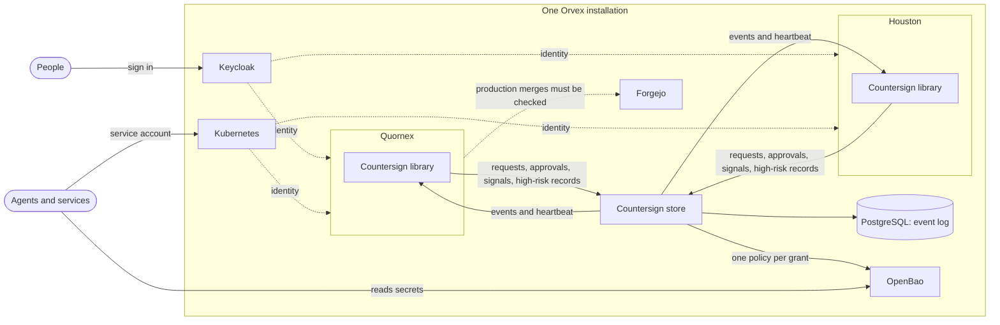
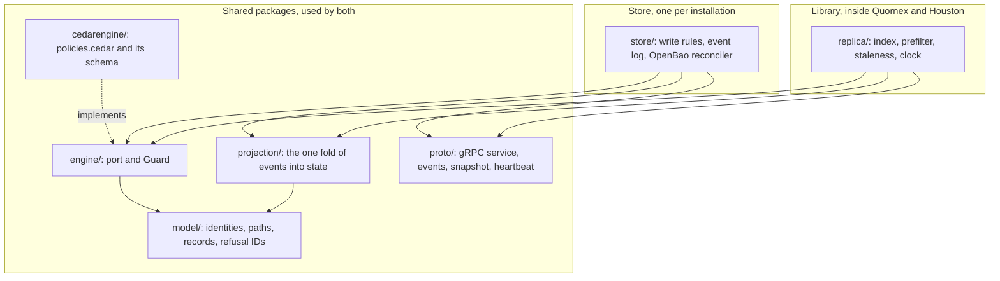
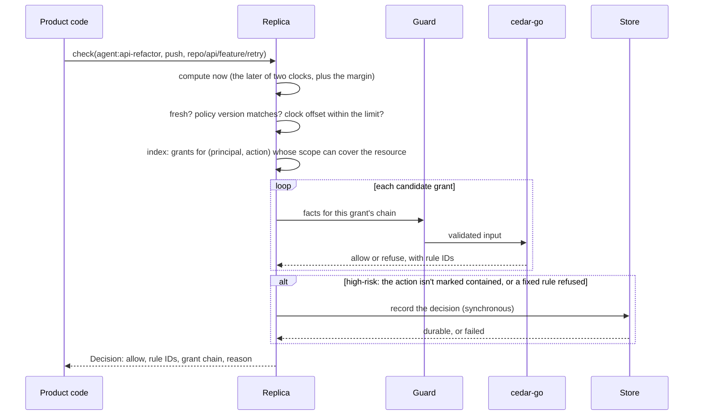
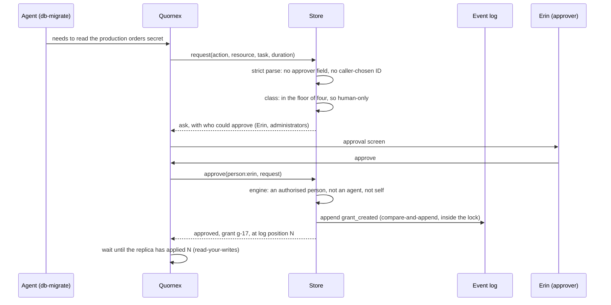
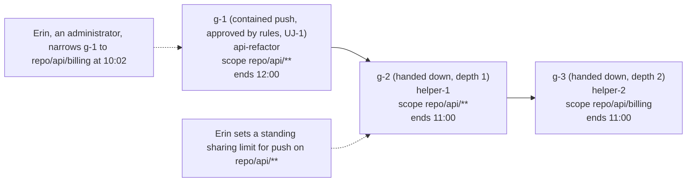
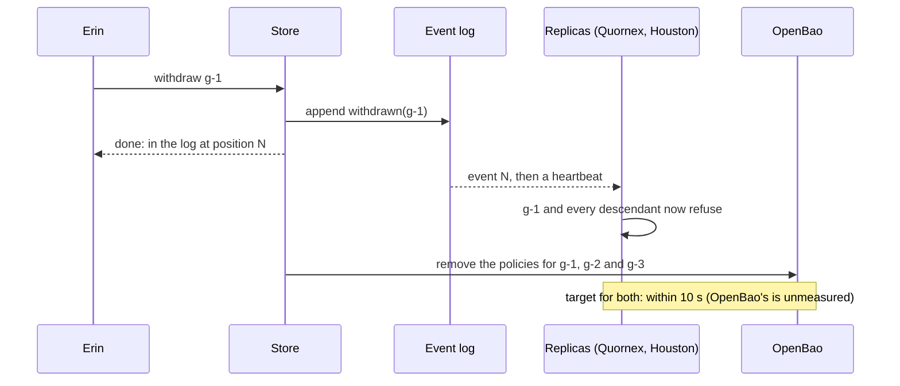
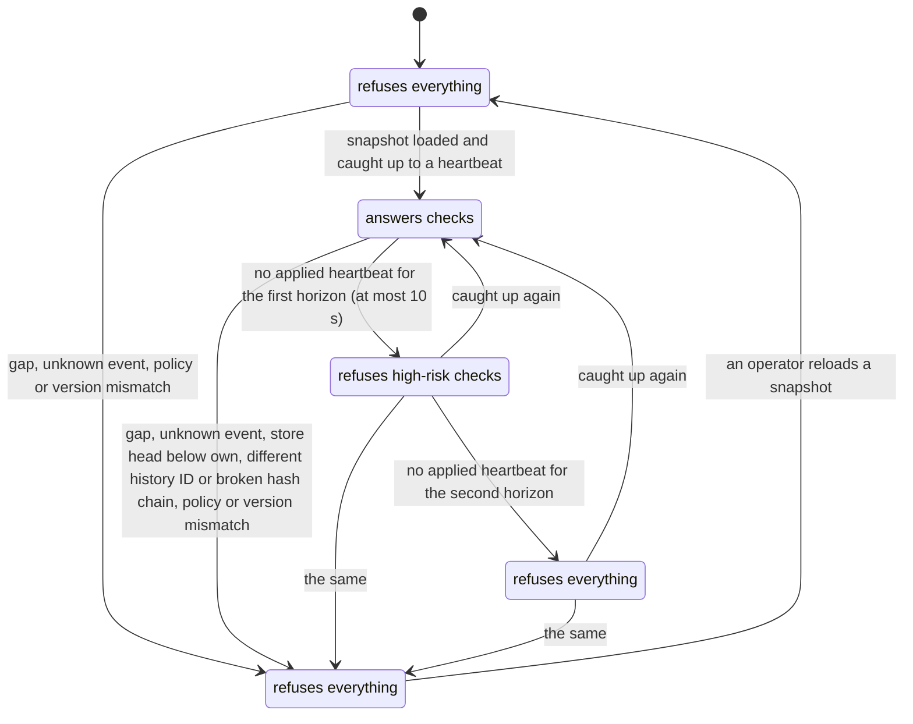

# Countersign: architecture

**Status:** draft for review, 2026-11-26. **Author:** Skander, working with an AI assistant; the collaboration is recorded in `AI_LOG.md`.

> **Summary**
>

> - **What it is:** a Go library inside Quornex and Houston answers every permission check locally. One store per installation is the only writer, to an append-only event log in PostgreSQL. OpenBao enforces secrets with one policy per grant.
> - **The safeguards:**
>   - Agents start with nothing.
>   - Contained actions are approved by rules; production, real secrets, money and deletion always wait for a person.
>   - Nobody approves their own request. Whether a person may approve a request from an agent they started (Sam's case) is open (§11).
>   - Delegated access only shrinks.
>   - Anything unknown, stale or malformed refuses.
> - **The engine is cedar-go**, chosen by a rule written down before measuring.
>   - **Run 6:** 25 of 25 decision-table rows. Rows 22 and 24 are replacements: the originals (a cut-off replica, and replay) never ran, because the spike has no replica.
>   - **A p99 of 41 µs per check against a 250 µs target, on the typical prefiltered path only.** The full path (259 µs) and the worst case (415 µs, and every engine) miss 250 µs. The scope index meant to fix the worst case isn't built.
>   - **The margin over OPA is thin:** 2.2× against a 2× line, on a shared VM. In the worst case, OPA was faster (385 µs against 415 µs).
>   - **14 properties of the policies are proved with SymCC,** run once by hand. The CI job isn't built. The proofs cover agents and the `push` action, under Rust Cedar's semantics. That cedar-go decides the same way is untested.
> - **How much is shown:** the decision logic is tested and the engine is measured. The store, replicas, replication, OpenBao and replay are **designed, not built or measured**. Section 11 lists what must be shown before v1.
> - **Open:**
>   - the high-risk record call (B10)
>   - Quornex's production gate (not confirmed with Danny)
>   - the products sending closing signals
>   - the questions for Danny (§11)

This document explains Countersign's architecture: its shape, how it works, why it's built this way, and what's still open. The binding rules are in [ARCHITECTURE-SPINE.md](ARCHITECTURE-SPINE.md), as decisions AD-1 to AD-23. This document cites them. **Where the two differ, the spine wins.**

| If you want… | Read |
|---|---|
| The rules teams build from | [ARCHITECTURE-SPINE.md](ARCHITECTURE-SPINE.md) |
| What the product must do | [the PRD](../../prds/prd-countersign-2026-11-06/prd.md) |
| The grant schema and the events | [grant-schema.md](grant-schema.md) |
| The 25 checks, 5 of them attacks, with results | [decision-table.md](decision-table.md) |
| How the engine was chosen, and the numbers | [spike-preregistration.md](spike-preregistration.md), [spike-results.md](spike-results.md), [spike-results-history.md](spike-results-history.md) |
| What is formally proved | [symcc-results.md](symcc-results.md) |
| What the spike didn't do | [../../../../spike/KNOWN-LIMITS.md](../../../../spike/KNOWN-LIMITS.md) |
| The architecture review and what happened to each finding | [reviews/triage.md](reviews/triage.md) |

## 1. What Countersign does

Countersign decides who, person or agent, may do what, where, and for how long, across Quornex and Houston.

- **Agents start with nothing.** They request access for a task, and it ends when the task ends.
- **Contained actions are approved by rules.** Production, real secrets, money and deletion (the **floor of four**) always wait for a person.
- **Nobody approves their own request** (Sam's case, a person approving a request from an agent they started, is open: §11). **Agents never approve a request.** A parent agent gives a child agent part of its own grant by **hand-down**. That's how Danny's "a parent can approve for its child" is modelled: the child gets the same or less, and only with a person's explicit permission to share.
- **Every decision can be explained and replayed later.**
- **OpenBao enforces what Countersign decides** for secrets.

## 2. The system in one picture

**Three parts:**

- **The library**, embedded in Quornex and in Houston. It answers checks locally, in process, from a read-only copy of the permissions (a **replica**).
- **The store**, one per installation. It's the only writer. It accepts requests, approvals, withdrawals and signals, and appends each change to an append-only **event log** in the installation's PostgreSQL.
- **OpenBao**, where the store writes one policy per grant, so secrets are enforced at the source.

**What Countersign doesn't do** (AD-18):
- It has no screens: Quornex and Houston show the approval screens.
- It doesn't authenticate anyone: Keycloak and Kubernetes do.
- It doesn't stop a production merge on its own: Quornex must route every production merge through a Countersign check. **That last dependency isn't confirmed with Danny yet** (PRD question 6b).

## 3. The main decisions at a glance

The tag column says how much evidence stands behind each decision. **Measured** means the spike measured it. **Proved** means SymCC proved it for every input the schema allows. **Tested** means a test in the spike exercises it. **Decided** means it's a design choice that hasn't been built or measured.

| Decision | Spine | Evidence |
|---|---|---|
| One writer per installation; checks are local | AD-1 | Decided |
| An append-only event log in PostgreSQL | AD-2 | Decided |
| A push stream with a heartbeat feeds the replicas | AD-3 | Decided |
| A stale replica fails closed in two steps | AD-4 | Decided (the spike has no replica) |
| Facts are recomputed at check time; who may write is decided at write time | AD-5 | Tested |
| **The engine is cedar-go, behind a port** | AD-6 | **Measured** (runs 5 and 6) |
| One input guard in front of every engine call | AD-7 | Tested (the differential test) |
| Fixed rules in Cedar, proved in CI | AD-8 | **Proved once by hand, CI to build:** 14 properties, with limits (§9) |
| An index and a prefilter before the engine | AD-9 | Prefilter measured; scope index decided, not built |
| Typed identities, strict parsing | AD-10 | Tested |
| Immutable grants; every change is an event | AD-11 | Tested |
| Time is an input, in whole milliseconds | AD-12 | Partly tested |
| The store reconciles OpenBao to the log | AD-13 | Decided (no OpenBao in the spike) |
| Every decision recorded; high-risk ones before answering | AD-14 | Decided in part: B10 is open, and the high-risk round trip is unmeasured and outside the 250 µs target |
| Lists filter item by item | AD-15 | Tested |
| The floor of four is lowered only by two administrators | AD-16 | Tested |
| The layer is the trust boundary | AD-17 | Tested; its CI guard isn't built |
| The boundary with Quornex and Houston | AD-18 | Decided; partly unconfirmed with Danny |
| One projection shared by the store and replicas | AD-19 | Decided |
| One policy version per installation | AD-20 | Decided |
| The wire contract | AD-21 | Decided |
| Limits are set at the store | AD-22 | Decided |
| One explanation shape; replay by log position | AD-23 | Decided |

**Most of the design is decided, not measured.** The spike tested the decision logic and chose the engine. It didn't build the store, the replica, replication, OpenBao or replay. Section 11 lists what must be shown before v1.

## 4. Parts and packages

**One fold of the log, shared (AD-19).** The store and every replica work out current state with the same `projection/` package: a grant's effective scope and end, whether it or any ancestor is withdrawn or ended, the action class, and who the administrators are. So a narrowing can never be read one way by the store and another way by a replica. The snapshot a new replica starts from is that package's state, sent through `proto/`.

**The engine only decides (AD-6, AD-17).** The **layer** (`projection/` and `replica/`) gathers facts and passes them to the engine, and the engine combines them into allow or refuse. This is the trust boundary: a wrong fact would be wrong for every engine. So the layer has its own tests, separate from the Cedar proofs.

## 5. How a check works

- **Before any engine call,** the replica refuses if it's stale, if its policy version differs from the installation's, or if its clock is too far from the store's.
- **The index and prefilter** mean the engine sees only grants that could cover the resource (AD-9). In the spike, **the prefilter alone** brought cedar-go's typical check from 259 µs to 41 µs (p99). The scope index isn't built.
- **Every engine call passes the Guard** (AD-7): canonical paths, typed identities, whole-millisecond times. Anything malformed or unknown refuses.
- **A high-risk check records its decision at the store before answering** (AD-14, decision D1). It's the only network call a check may make. If the store is down, high-risk checks refuse, and contained checks carry on.
- **The answer has one fixed shape** (AD-23). An allow names the allowing grant with the lowest log position. A refusal gives the most important reason, so two replicas, or a replay, explain the same decision the same way.

**Lists** (AD-15): a list decides each item exactly as a single check would, and leaves out the items that aren't allowed. The whole list is refused, with a reason, only if the list itself can't be decided: malformed input, an engine error, a replica past its second staleness horizon, or the deadline. A refused list is never an empty list that a product could read as "no items".

## 6. How access is granted

**A contained request** (for example, a push to a feature branch) is approved by rules within 2 s, for at most 4 h (both tentative), and the grant records the rule as its approver (FR-10). Everything else asks a person.

**Who the approver is rests on the products** (AD-18). The store accepts calls only over mTLS from the products' own service identities, and it takes the person's identity as the product asserts it. Checking that the caller matches that identity is the products' job in v1 (E17). So "nobody approves their own request" and human-only approval both depend on the products getting identity right. That's a stated residual risk.

**Write-time rules are checked once, at the store,** against the state just before the new event, inside the transaction that appends it (AD-2, AD-5). A store that has lost the single-writer lock can't append against stale state (AD-1, finding B1).

**Handing down** (delegation): a parent agent can give a child agent part of a grant only with explicit permission to share it. The child gets the same or less, and ends no later than its parent. **Depth** is the number of hand-downs below the root grant, at most 3 (tentative; AD-8, AD-22). In the example below, g-2 is at depth 1 and g-3 at depth 2.

`api-refactor` holds a contained push grant, approved by rules as in UJ-1. It hands parts of it down to helper agents, which a contained grant allows only within a standing sharing limit that a person has set (FR-8). **At check time, a grant's power is its overlap with every ancestor as it is now** (AD-5, AD-19). After Erin narrows g-1, g-2 can't push to `repo/api/payments`, even though g-2's own scope still says `repo/api/**`. The same function, `EnforcedScope`, decides what OpenBao is given, so OpenBao and the checks can't disagree (AD-13, finding B2).

### Where each fixed rule is enforced, and how it's shown

The PRD has 13 fixed rules (NFR-5). They're enforced in different places, with different evidence:

| # | Rule | Enforced in | Evidence |
|---|---|---|---|
| 1 | Default deny | Cedar (only `check.grant-allows` permits) | Proved for agents on `push`; tested |
| 2 | A request never names its approver | Strict parsing at the store (AD-10) | Tested |
| 3 | Every grant has a hard maximum lifetime | The store's Go code, when the write is accepted (AD-5) | Tested |
| 4 | Markings never remove an action from the floor of four | Cedar `forbid` | Proved; tested |
| 5 | Only an authorised person approves a human-only action | Cedar `forbid` plus typed identities | Proved; tested |
| 6 | Nobody approves their own request | Cedar `forbid` | Proved for person requesters; tested |
| 7 | Approval is attached to the final action | An ordinary check, plus Quornex's production gate | Check side tested; **the gate depends on Quornex** |
| 8 | Delegated access only shrinks | Cedar permit conditions, plus the projection | Proved (agents, `push`); tested |
| 9 | A child grant ends with its parent | Cedar permit conditions, plus the projection | Proved (agents, `push`); tested |
| 10 | Access that can't be enforced isn't allowed | The OpenBao reconciler (AD-13) | **Not tested:** no OpenBao in the spike |
| 11 | Handing down needs explicit authorisation | Cedar permit conditions | Proved; tested |
| 12 | Agents never set markings, authority or sharing | Cedar `forbid` (markings); typed identities (the rest) | Markings proved; all tested |
| 13 | An agent-created service grant gains nothing new | Cedar permit conditions | Proved; tested |

**Some write rules stay in Go, tested but not proved** (decision D15): who may narrow or withdraw, classification, giving approval authority, sharing limits, service-grant authorisations, and adding or removing administrators. Moving them into Cedar would bring them under the proofs, but at the cost of new engine methods.

## 7. How access is taken away

Access ends at the first of these:
- its time limit
- its task closing (`task_closed`)
- its agent ending (`agent_ended`)
- the hard maximum
- a withdrawal
- a narrowing that no longer covers the resource
- the same happening to any ancestor

"Done" means the withdrawal is in the log. OpenBao follows within its 10 s target, and `policy_removed` records which log position it reflects (AD-13). Its lag hasn't been measured, and what alerts on it is part of observability, which is deferred.

**Closing signals come from the products** (AD-18). The products sending them reliably is **an assumption to check with Danny**.
- **"Task closed" ends every grant for that task,** even one approved after the close, because a task is never reopened (AD-11, finding B4).
- **"Agent ended" ends the grants made before it,** because Kubernetes can reuse a service-account name.

**OpenBao follows the same projection** (AD-13, decision D6):
- A grant's policy exists only while the grant and every ancestor are live.
- It expires at the earliest end over the chain, minus the clock safety margin.
- It's attached to the agent's OpenBao identity, never to a token, so removing it takes effect on the next request.
- The store removes policies it created. Access added by hand raises an alert.

## 8. Time, staleness and failure

A replica that can't hear the store must not keep honouring a withdrawn grant (AD-4).

- **Freshness counts applied events, not received heartbeats** (decision D4). A replica whose applying is stuck becomes stale even while heartbeats keep arriving.
- **`now` is the later of two clocks:** the wall clock, and the store's time at the last heartbeat plus the time elapsed since. A safety margin is added. A grant ends as soon as either clock reaches its end, and a wall clock that moves backwards can never lengthen access.
- **The second horizon is capped at 5 minutes (tentative, unmeasured).** So on a cut-off replica, a withdrawn contained grant can be honoured for up to 5 minutes.
- **Contained checks carry on until the second horizon.** That's a stated exception to the brief's "100% of descendants refused within 10 s": for contained grants, 10 s holds only on connected replicas.
- **This whole mechanism has never run.** The spike had no replica. The horizon and margin values are deferred.

| Failure | What happens |
|---|---|
| The store is down | Writes and high-risk checks refuse. Contained checks continue until the second horizon. |
| A replica is cut off | High-risk checks refuse after the first horizon; everything refuses after the second (at most 5 minutes, tentative). |
| A replica's applying is stuck | The same as cut off: freshness counts applied events only. |
| Two store processes run at once | Only the holder of the advisory lock writes. Every append checks the head it expects. A writer epoch goes up each time a store takes the lock. Before each OpenBao write, the reconciler checks the epoch is still its own and stamps it into the policy's metadata; a reconciler that sees a newer epoch in OpenBao stops (AD-1). |
| Quornex and Houston run different policy versions | A replica whose policy hash or decision-code version doesn't match the installation's refuses every check (AD-20). |
| A clock jumps | `now` takes the later clock. A replica whose offset from the store is too large refuses every check. |
| OpenBao can't express a restriction | The access isn't created, and the refusal names the restriction (AD-13). |
| The event log is restored from a backup | The restore procedure mints a new history ID. A replica that sees a different history ID, or an event that doesn't extend its hash chain, halts and refuses every check until an operator reloads a snapshot (AD-21, B3). **Decided, not built.** Until it's built, the interim rule applies (§11). |

## 9. The policy engine: why cedar-go, and what's proved

**How it was chosen.** Before measuring, the spike wrote down its thresholds and its tie-break rule ([spike-preregistration.md](spike-preregistration.md)). Every change made after a measurement is recorded there, and every run is kept. Three engines ran the same 25-row decision table: cedar-go, OPA, and a reference engine written in Go (not a candidate). The setup:
- 50,000 grants, written while checks run
- 3 runs per measurement
- pinned to 3 CPUs on a 4-vCPU virtual machine

Results from run 6, the run on the final policies:

| Engine | Rows passed (wrong allows) | Typical p99, prefiltered | Typical p99, full path | Worst case p99, prefiltered |
|---|---|---|---|---|
| **cedar-go** | 25 of 25 (0) | **41 µs** | 259 µs | 415 µs |
| OPA | 25 of 25 (0) | 91 µs | 705 µs | 385 µs |
| Reference (Go) | 25 of 25 (0) | 19 µs (unstable) | 30 µs (unstable) | 364 µs |

- **Both candidates passed the rows. cedar-go was 2.2× faster on the typical prefiltered path, past the pre-registered 2× line, so the rule chose cedar-go.**
- **In the worst case, OPA was faster** (385 µs against 415 µs). The pre-registered rule judges the typical case only, because the worst case fails on every engine, the reference included, which makes it a finding about the layer. The comparison is re-run once the scope index exists (§11).
- **The margin over that line is thin:**
  - Runs 5 and 6, pinned, both gave 2.2×.
  - **Earlier, unpinned runs gave different ratios:** about 1.0 in run 2b (OPA 158 µs, cedar-go 160 µs) and 1.9 in run 4 (144 µs and 76 µs, with cedar-go unstable).
  - The machine is a virtual machine on a shared host that shows CPU steal time. Pinning reduces noise inside the VM only.
  - **Before v1, the pre-registered comparison is re-run on representative hardware.** If the ratio falls below 2×, the pre-registered tie-break order decides. The engine port (AD-6) keeps a switch cheap.
- **cedar-go passes 250 µs only with the prefilter.** Its full path was 249 µs in run 5 and 259 µs in run 6.
- **The worst case (one agent with 5,000 grants) fails 250 µs on every engine, including the reference.** That makes it a finding about the layer: the prefilter still loops over every grant. A scope index must fix it (AD-9). The index isn't built, so this is unproven.
- **Memory per check (cedar-go, prefiltered):** 4,464 bytes in the typical case, 45,234 bytes in the worst case. **The store:** about 650 bytes per grant, from run 2b, before the final policies, counting the spike's combined store and replica with only a principal index. It wasn't re-measured, and it isn't the product's layout.

**What SymCC proves** ([symcc-results.md](symcc-results.md)). The SymCC symbolic compiler, with the cvc5 solver, proved 14 properties, in one run by hand (the CI job isn't built yet), of `policies.cedar` for every request and entity store the schema allows. Two deliberately false claims were refuted, as they must be, and breaking the self-approval rule made SymCC find a counterexample. So the proofs aren't vacuous.

**What it doesn't prove:**
- **The layer's facts:** whether someone is an administrator, holds the access, whether a chain is withdrawn, and so on. These are inputs, tested separately (AD-17).
- **Checks by people, and check actions other than `push`.**
- **Self-approval when the requester is an agent.** Agents can't approve at all, which is proved.
- **That cedar-go decides exactly like the Rust Cedar that SymCC analyses.**
- **Rules 2, 3, 7 and 10,** which live outside Cedar.

**The v1 CI work (decisions D17 and D18) closes most of these gaps:**
- widen the schema and the actions SymCC analyses
- prove that the policies never error
- add a cedar-go vs Rust conformance test
- check that each action has exactly one `permit` per principal type, so no new `permit` can bypass the conditions inside it

A new `forbid` will also stop a grant approved by rules from allowing an action that has since been marked human-only (finding B5).

## 10. Recording, explaining and replaying

- **Every decision is recorded** (AD-14). A high-risk check's record is durable at the store before the answer. An approval or withdrawal is recorded by the event itself. Other checks are recorded asynchronously, so **a crash can lose contained-check records not yet sent**, and "every decision is recorded" and 100% replay don't hold for them until B10 is settled.
- **A record carries what replay needs** (AD-23):
  - the log position the replica had applied
  - the `now` it used, its clocks and its staleness
  - the policy hash and the decision-code version
  - the full `Decision`
- **Replay** rebuilds the state at that log position with the same `projection/` code, then decides with the recorded engine version. A replay that disagrees with the record raises an alert. Records are kept for at least a month.
- **Explanations** name the engine's rule IDs, the grant chain up to the first approval, and, on a refusal, the deciding fact ("Erin withdrew it at 09:14") and who could approve.

Replay wasn't tested in the spike. The original decision-table row 24 (replay), which was replaced in the spike and tracked apart, must pass before v1.

## 11. What is still open

### Decided, not built or measured

- **B3, a restored event log** (AD-2, AD-3, AD-21):
  - The log has a history ID, a ULID or UUID, never a counter. The restore procedure mints a new one on every restore.
  - Every event carries the hash of the previous event.
  - Stream resume, the heartbeat and the snapshot carry the history ID and the head hash.
  - A replica that sees a different history ID, or an event that doesn't extend its hash chain, goes to Halted and refuses every check until an operator reloads a snapshot of the new history.
  - Store-assigned IDs are ULIDs, so no ID repeats after a restore.
  - **Layer test:** restore a log from an older backup, let the head climb past a replica's position, and check that the replica halts.
  - **Known limit:** If an operator recreates the database without the restore procedure, the history ID doesn't change, but the hash chain still catches the fork when a replica resumes. The protection fails only if the restored events are identical to what the replica applied.
  - **Interim operating rule, until it's built:** after any PostgreSQL restore, stop the store and re-initialise every replica from a fresh snapshot of the restored log before writes resume. The store team owns it, before v1.

### Open risks

1. **B10, the high-risk record call (open).** What the store does with a high-risk record isn't fixed yet:
   - whether it re-checks the decision against newer events
   - where records are stored
   - how retries are handled
   - how compact records survive a crash
   - what a list sends
2. **The production gate.** Rule 7 depends on Quornex routing every production merge through a check. Until that exists, splitting a change across merges is a gap, and a deviation from the brief.
3. **Closing signals from the products.** The products sending "task closed" and "agent ended" reliably is assumed.
4. **Grants approved by rules after their action becomes human-only** keep allowing until the v1 `forbid` (B5) is in place.

5. **Also open, from bmad-review** ([reviews/bmad-review-2026-11-26.md](reviews/bmad-review-2026-11-26.md)):
   - **A9:** a reused service-account name could inherit the old agent's OpenBao policies before the reconciler acts.
   - **A14:** read-your-writes covers only the writing product's replica, with no stated timeout result.
   - **A22:** the reconciliation interval, the drift method and the alert recipient, and named owners for operations.

Medium and low findings from the architecture review (B11–B22, B26, B27) are listed in [reviews/triage.md](reviews/triage.md).

### Questions for Danny or the PRD owner

- FR-17 says withdrawing a service grant takes back its child grants, but FR-16 says a service grant is never handed down. One of them must change.
- NFR-4's "an unauthenticated identity is refused" has become each product's job (AD-18). That's a PRD change.
- **Sam's case (addendum seed 2, PRD §9 question 4) is not settled.** Sam starts `api-refactor`, which asks to deploy to production, and Sam approves it. Is that self-approval?
  - Sam and the agent are different principals, so `approve.forbid-self` doesn't refuse it.
  - The self-approval proof covers person requesters only, not agent requesters.
  - It needs Danny's answer.
- Unclassified resources count as production. That widens the floor-of-four assumption.
- Danny's "a parent can approve for its child" is modelled as hand-down within a person's sharing limit, with agents never approving. Does that meet what he meant?
- Does each installation have its own PostgreSQL? AD-2 depends on it.
- Every question in PRD §9.

### Not decided yet, by design

- The values of the staleness horizons (the second is capped at 5 minutes, tentative), the clock margin and the maximum offset
- The scope index's structure
- The service grant's hard maximum
- A time budget for lists
- Record retention beyond a month
- How closing signals are authenticated
- Setting the first administrator, and recovering when every administrator has lapsed
- **Operations, each with an owner:** deployment, observability and alerts, backup and restore, migrations, tamper detection

### Before v1

- The replica, including the original decision-table rows 22 (a replica cut off from the store) and 24 (replay), both replaced in the spike and tracked apart
- The scope index, measured against the worst case
- The OpenBao reconciler, with an agreement test against a real OpenBao, the `EnforcedScope` property test, and a measurement of 5,000 policies on one entity
- B3's history ID and hash chain, with the restore layer test
- The high-risk record call's round trip, measured
- The engine comparison, re-run on representative hardware, and again once the scope index exists
- The CI checks from D17 and D18, the B5 `forbid`, and the AD-17 registry test

## 12. Where the product differs from the spike

The spike tested the decision logic; it isn't the product. In three places, the architecture review deliberately moved away from the spike's code:

- **Tasks.** The spike lets a closed task be reopened, and treats "task closed" as ending only earlier grants. The product never reopens a task, and "task closed" ends every grant for it (AD-11).
- **One state.** The spike has one in-memory state, protected by a lock, playing both store and replica. The product has a separate store and replicas sharing `projection/`, and the replica's state is swapped atomically, so checks never wait (AD-9, AD-19).
- **Engine methods.** The spike has a `Lister` port. The product decides lists one check per item (AD-6).

## Glossary

| Term | Meaning |
|---|---|
| Grant | A permission: who may do what, where, for which task, until when, and who approved it |
| Contained | An action that rules may approve without a person |
| Human-only | An action that only an authorised person may approve |
| Floor of four | Production, real secrets, money and deletion: always human-only |
| Marking | An administrator's setting that makes an action contained or human-only on a resource |
| Hand-down | A parent agent giving a child agent part of its grant |
| Replica | The read-only copy of the permissions inside each product |
| Store | The single writer, one per installation |
| Projection | The code that turns the event log into current state |
| Horizon | How long a replica may go without an applied heartbeat before it refuses |
| Layer | The code that computes the facts the engine decides on |
| High-risk | A check on an action that isn't marked contained. A stale replica refuses it after the first horizon, and its decision, like any refusal by a fixed rule, is recorded at the store before answering (AD-4, AD-14) |
| Heartbeat | The store's message every second, with its latest log position and its time; it keeps replicas fresh and measures clock offset |
| Log position | An event's number in the event log; the state version |
| Standing sharing limit | A person's advance permission for contained grants of one action on one resource to be handed down, and how far |
| Service grant | A grant owned by a team or role, for a service that must outlive its creator; never handed down |
| Administrator | An installation administrator, the root of authority; at least two, and in v1 the only people with authority over resources |
| `EnforcedScope` | A grant's scope narrowed by every ancestor's current scope; what checks and OpenBao both use |
